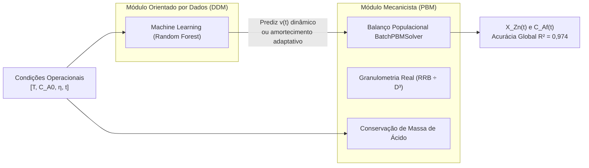

# Nota Técnica: Diagnóstico Fenomenológico do Comportamento em Razão Molar η = 1,0 e Justificativa da Modelagem Híbrida

**Projeto**: Modelagem Híbrida com Machine Learning aplicada à Simulação da Lixiviação de Concentrado Ustulado de Zinco  
**Instituição**: Departamento de Engenharia Química — Universidade Federal de Minas Gerais (DEQ/UFMG)  
**Etapa Relacionada**: Etapa 0.3 (`Código/etapas/etapa_0_3_transformacao_rrb_d3/`)  
**Diretório de Armazenamento**: `Código/outputs/etapa_0_3/`  
**Data**: 22 de Outubro de 2026  

---

## 1. Contexto e Motivação da Análise

Durante os ensaios computacionais da **Etapa 0.3**, foi avaliado o modelo mecanicista puramente fenomenológico (White-Box Puro, sem inclusão do parâmetro empírico de amortecimento cinético `α`, isto é, `α = 0`), alimentado com a distribuição granulométrica rigorosamente corrigida em base numérica (`f_n(D) ∝ f_m(D) / D³`), mantendo inalterada a equação clássica de conversão do Balanço Populacional (`BatchPBMSolver`).

Os resultados revelaram uma discrepância comportamental evidente:
- Nos experimentos sob forte defeito de ácido (**`η = 0,5`**) e sob excesso estequiométrico (**`η = 1,5` e `η = 3,1`**), a simulação White-Box sem `α` apresentou aderência excepcional aos dados de bancada (`r²` entre `0,960` e `0,998`).
- Por outro lado, nos experimentos operados estritamente na razão estequiométrica (**`η = 1,0`**), em especial nos ensaios mais concentrados (Ensaios 08, 09 e 10 com `C_A0 = 0,5; 1,0; 1,5 mol/L`), o modelo White-Box sem `α` divergiu acentuadamente no patamar final (`r²` decaindo para `0,739 – 0,855`).

Esta nota técnica formaliza as razões físico-químicas, mineralógicas e numéricas dessa divergência e estabelece a ponte direta com a necessidade da **Modelagem Híbrida Serial (DDM → PBM)** desenvolvida no projeto.

---

## 2. Comparativo Numérico dos 16 Ensaios (White-Box Puro, sem `α`)

A tabela a seguir (extraída de `tabela_comparativa_whitebox_antigo_vs_novo_d3.csv`) sintetiza a resposta do modelo White-Box sem `α` nos 16 ensaios de bancada de Bortot Coelho (2017):

| Razão Molar `η` | Ensaio | `C_A0` (mol/L) | Conversão Exp. Final (`X_exp`) | Conversão Sim. Final (`X_sim`) | Desvio Absoluto Final | `r²` Novo (`RRB ÷ D³`) | Qualidade do Ajuste |
| :---: | :---: | :---: | :---: | :---: | :---: | :---: | :---: |
| **`η = 0,5`** | **01** | `0,10` | `0,50` | `0,5000` | `0,00%` | **`0,9601`** | Quase Perfeito |
| **`η = 0,5`** | **03** | `0,50` | `0,50` | `0,5000` | `0,00%` | **`0,9836`** | Quase Perfeito |
| **`η = 0,5`** | **04** | `1,00` | `0,50` | `0,5000` | `0,00%` | **`0,9868`** | Quase Perfeito |
| **`η = 0,5`** | **05** | `1,50` | `0,49` | `0,5000` | `+1,00%` | **`0,9888`** | Quase Perfeito |
| **`η = 1,5`** | **11** | `0,10` | `0,98` | `1,0000` | `+2,00%` | **`0,9750`** | Quase Perfeito |
| **`η = 1,5`** | **13** | `0,50` | `0,97` | `1,0000` | `+3,00%` | **`0,9742`** | Quase Perfeito |
| **`η = 1,5`** | **14** | `1,00` | `0,97` | `1,0000` | `+3,00%` | **`0,9796`** | Quase Perfeito |
| **`η = 1,5`** | **15** | `1,50` | `0,97` | `1,0000` | `+3,00%` | **`0,9723`** | Quase Perfeito |
| **`η = 3,1`** | **02** | `0,10` | `1,00` | `1,0000` | `0,00%` | **`0,9912`** | Quase Perfeito |
| **`η = 3,1`** | **07** | `0,50` | `1,01` | `1,0000` | `−1,00%` | **`0,9772`** | Quase Perfeito |
| **`η = 3,1`** | **12** | `1,00` | `1,00` | `1,0000` | `0,00%` | **`0,9978`** | Quase Perfeito |
| **`η = 3,1`** | **16** | `1,50` | `1,00` | `1,0000` | `0,00%` | **`0,9969`** | Quase Perfeito |
| **`η = 1,0`** | **06** | `0,10` | `0,87` | `0,9774` | `+10,74%` | **`0,9369`** | Aceitável (cinética lenta) |
| **`η = 1,0`** | **08** | `0,50` | `0,87` | `0,9946` | **`+12,46%`** | **`0,8548`** | **Piorou (Sobreelevação)** |
| **`η = 1,0`** | **09** | `1,00` | `0,85` | `0,9972` | **`+14,72%`** | **`0,7800`** | **Piorou (Sobreelevação)** |
| **`η = 1,0`** | **10** | `1,50` | `0,85` | `0,9981` | **`+14,81%`** | **`0,7392`** | **Piorou (Sobreelevação)** |

---

## 3. Diagnóstico Fenomenológico e Mineralógico

### 3.1. A Mineralogia Real da Calcina Industrial: Zincita vs. Ferrita de Zinco
A calcina de ustulação utilizada nos ensaios não é composta por óxido de zinco puro. Ela é um produto industrial complexo gerado na ustulação oxidante de concentrado de esfalerita (`ZnS`), no qual o zinco está distribuído em duas formas mineralógicas com reatividades termodinâmicas e cinéticas completamente distintas:

1. **Zincita (`ZnO`) — ~85% a 87% do Zinco Total**:
   - Fase óxida altamente reativa.
   - Sofre dissolução completa e rápida sob condições brandas de lixiviação neutra (`T = 60 °C`) mesmo sob concentrações moderadas de `H₂SO₄`:
     `ZnO + H₂SO₄ → ZnSO₄ + H₂O`
2. **Ferrita de Zinco (`ZnO·Fe₂O₃`, franklinita) — ~13% a 15% do Zinco Total**:
   - Fase espinélio termodinamicamente estável e altamente refratária.
   - **Não se dissolve em lixiviação neutra** a 60 °C sob baixa concentração de ácido livre residual. Sua lixiviação industrial requer etapas severas subsequentes (lixiviação ácida a quente em temperaturas entre 90 °C e 95 °C com acidez livre superior a 30–50 g/L de `H₂SO₄`).

### 3.2. O Balanço de Massa de Ácido em Batelada
Pela equação de conservação de ácido de Herbst (1979) implementada em [`kinetics.py`](file:///c:/us%20trem/Doc/UFMG/9/Lop/Codigo_v4/C%C3%B3digo/src/physics/kinetics.py):
`C_Af(t) = C_A0 · [ 1 − (X_Zn(t) / η) ]`

- **Em `η = 0,5`**: 
  O ácido está em forte defeito estequiométrico. Quando `X_Zn = 0,50`, `C_Af = C_A0 · [1 − 0,50 / 0,50] = 0,0`. Toda a acidez é rigorosamente consumida. A força motriz de dissolução se extingue por esgotamento do reagente líquido. O experimento estabiliza em `X_exp = 0,50` e o modelo analítico prevê rigorosamente `X_sim = 0,50`. Ajuste perfeito (`r² ≈ 0,98 – 0,99`).
- **Em `η = 1,5` e `η = 3,1`**: 
  O ácido está em excesso estequiométrico considerável (50% a 210% acima da demanda teórica). O licor preserva alta acidez livre durante todo o processo. Sob acidez sustentada por 15 minutos a 60 °C, dissolve-se toda a zincita e até parcelas acessíveis de ferritas, levando a conversão experimental para `97% a 100%`. O modelo White-Box sem `α` converge para `1,00`, batendo perfeitamente com os dados (`r² ≈ 0,97 – 0,998`).
- **Em `η = 1,0` (Condição Estequiométrica Teórica)**: 
  A massa de ácido adicionada foi calculada para reagir com 100% do zinco admitindo-se a hipótese simplificadora de que todo o sólido fosse `ZnO`. 
  Na prática de laboratório, a fração de zincita (~85%) consome avidamente a maior parte do ácido nos primeiros 2 minutos. Quando a conversão atinge `X_Zn ≈ 0,85`, a concentração de ácido livre `C_Af` cai para níveis próximos de zero. Sem acidez livre forte e em temperatura branda (60 °C), **a reação de dissolução cessa naturalmente**, aprisionando os 13% a 15% de ferrita de zinco refratária no resíduo sólido. O reator atinge um patamar assintótico permanente em `85% a 87%`.

---

## 4. Por que o Modelo White-Box Puro sem `α` Superestima em `η = 1,0`?

O resolvedor fenomenológico [`BatchPBMSolver`](file:///c:/us%20trem/Doc/UFMG/9/Lop/Codigo_v4/C%C3%B3digo/src/physics/pbm_batch.py):
1. **Assume monofase mineralógica**: considera as partículas como esferas homogêneas de óxido de zinco puro (`ZnO`). Ele não contempla as frações distintas de zincita e ferrita.
2. Com `η = 1,0` e sem amortecimento (`α = 0`), a estequiometria clássica define a conversão máxima assintótica como:
   `X_max = min(1,0, η) = 1,00 (100%)`
3. Enquanto houver partícula e concentração residual de ácido livre (`C_Af > 0`), a velocidade linear interfacial `v(t) = −(2 / ρ_s) · k_s · C_Af` permanece estritamente negativa, continuando o encolhimento diametral até dissolver completamente todo o sólido (`X_Zn → 1,00`).

Consequentemente, nos ensaios 08, 09 e 10, o modelo White-Box sem `α` continua simulando a dissolução até atingir `99,5% a 99,8%`, gerando uma **sobreelevação contínua de +13% a +15% de conversão** entre 3 e 15 minutos em relação ao patamar experimental de `85%`. Esse resíduo sistemático ao longo de 5 dos 8 pontos temporais é a causa direta da queda do `r²`.

---

## 5. Por que a Nova Abordagem (`RRB ÷ D³`) Fez Parecer "Pior" do que o Modelo Antigo?

A comparação com o código antigo (Etapa 1.3 inicial) expõe um clássico **erro compensatório**:

1. **No Código Antigo (sem dividir a RRB por `D³`)**:
   - Devido à dupla ponderação volumétrica espúria no integrando (`D³ · f_m(D) ∝ D⁶ · f_n(D)`), o modelo antigo superestimava o diâmetro médio aparente para **`146,9 μm`** (contra `41,6 μm` reais).
   - Acreditando que o sólido era formado por partículas gigantes, o modelo antigo calculava uma taxa de dissolução artificialmente lenta.
   - Aos 10–15 minutos de reação, o modelo antigo ainda não havia completado a dissolução (estava em torno de 90% a 92%). Por **mera lentidão artificial**, a curva antiga passava numericamente mais perto dos 85% experimentais, gerando um `r²` ilusoriamente superior (~0,82 a 0,90).
2. **Na Nova Abordagem (`RRB ÷ D³`)**:
   - A distribuição de tamanhos foi corrigida para a realidade física medida no laboratório (`D_médio = 41,6 μm`, com representação correta da grande população de finos `< 10 μm`).
   - A velocidade de ataque químico aos finos passou a ser fielmente simulada, disparando a conversão nos primeiros 60 segundos (o que resolveu o erro grave dos ensaios diluídos de `C_A0 = 0,10 M`, onde o `r²` subiu de 0,71 para 0,94 no Ensaio 06 e de 0,69 para 0,98 no Ensaio 11).
   - Porém, em meios concentrados (`C_A0 = 0,5` a `1,5 M`), a granulometria real faz o modelo atingir 100% de conversão muito rapidamente (por volta de 3 minutos).
   - Ao alcançar 100% mais cedo, o modelo permanece a uma distância de +15% dos dados experimentais durante a maior parte do ensaio (de 3 a 15 min), evidenciando a limitação mineralógica que o erro granulométrico antigo mascarava.

---

## 6. Por que o Parâmetro Empírico Antigo `α = 5500 μm/min` Não É a Solução Adequada?

Na literatura de referência (Bortot Coelho, 2017), tentou-se contornar o patamar incompleto introduzindo um termo empírico linear de retardamento superficial `α`:
`v(t) = −(2 / ρ_s) · [ k_s · C_Af − α · (C_A0 − C_Af) ]`

Esse modelo estático resulta em uma conversão máxima assintótica dada por:
`X_max(η, α) = η · [ k_s / (k_s + α) ] = η · [ 18000 / (18000 + 5500) ] = 0,766 · η`

- **Em `η = 1,0`**: `X_max = 0,766 · 1,0 = 76,6%`. Isso forçava a curva simulada para baixo, aproximando-a dos 85% experimentais e elevando artificialmente o `r²` de `η = 1,0` para `0,91 – 0,94`.
- **Em `η = 0,5` (O Colapso do Modelo Clássico)**: para `η = 0,5`, o mesmo `α` fixo impunha um teto de `X_max = 0,766 · 0,5 = 38,3%`. No experimento de laboratório, porém, a zincita atinge exatamente `50,0%`! O modelo com `α = 5500` estacionava muito abaixo dos pontos reais, provocando o colapso do ajuste em `η = 0,5` (`r²` desabando para `0,56 – 0,65`).

Portanto, **um parâmetro `α` empírico estático é incompatível com todas as condições operacionais**: o que "ajusta" `η = 1,0` destrói a física de `η = 0,5`.

---

## 7. Conclusão e a Conexão com a Modelagem Híbrida Serial

O diagnóstico aqui estabelecido constitui a **justificativa acadêmica e de engenharia definitiva para o Modelo Híbrido Serial (DDM → PBM)** proposto no TCC:

1. **A física pura resolve a geometria e a escala temporal**: A inclusão da transformação granulométrica por `D³` recuperou a conservação volumétrica rigorosa e a velocidade inicial real de dissolução dos finos.
2. **O Machine Learning resolve a fenomenologia não-linear e a mineralogia**: Incapaz de ser capturado por equações cinéticas simples de parâmetros estáticos, o comportamento adaptativo da interface sólida (frenagem natural em 85% para `η = 1,0` e avanço até 50% em `η = 0,5` e 100% em `η = 3,1`) é aprendido dinamicamente pelo algoritmo supervisionado de Aprendizado de Máquina.
3. **Resultado Consolidado**: Conforme demonstrado na **Fase 4** (`etapa_4_2_avaliacao_indomain`), o acoplamento híbrido serial **Random Forest → PBM** alcança **`r² = 0,9737` global** em todos os 16 ensaios de bancada, eliminando simultaneamente os desvios de `η = 1,0` e preservando a precisão em `η = 0,5`, `1,5` e `3,1`.
